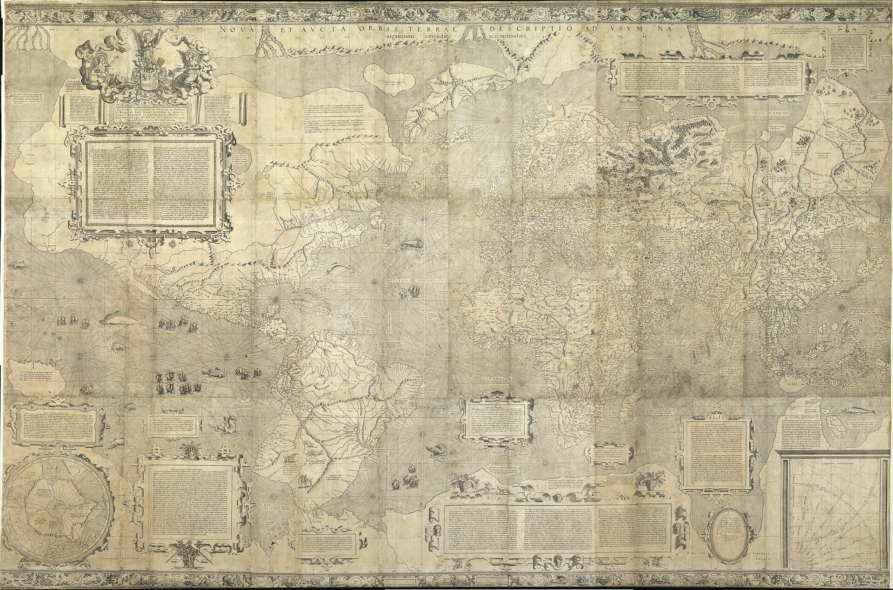

# The Map

:::{.column-page-right}

:::

# Text Blocks

There is a *lot* of text on this map. What can I say, I like sharing information! For easier enjoyment, the text has been rendered in English below.

## To the most illustrious and clement prince

TO THE MOST ILLUSTRIOUS AND CLEMENT PRINCE AND LORD WILHELM DUKE OF JUILLERS, OF CLEVES AND OF MONT, COUNT OF THE MARCHES AND OF RAVENSBURG, LORD OF RAVENSTEIN, this work, commenced and ended under his favourable patronage, was dedicated by Gerhard Mercator.

## Happy countries, happy kingdoms

Happy countries, happy kingdoms in which Justice, noble progeny of Jupiter, reigns eternal and where Astraea, having regrasped her sceptre, associates herself with divine goodness, raising her eyes straight to the heavens, governs all in accordance with the will of the Supreme Monarch and devotes herself to the submission of unfortunate mortals to His sole empery, seeking happiness. 

There undisturbed Peace, companying with all-powerful Justice which guides it, and Piety, which no trials have cast down, make the curb pleasant, easy and firm thanks to the loving obedience of the peoples and, by Divine favour, hearts ever become greater, come such fortune as may; and though Impiousness, the enemy of virtue, causing Acheron to riot, raises some gloomy disorder, no terror is felt: this allgood Father who, residing on the crest of the world, orders all things by a nod of His head, will never desert His works or His kingdom.

When the citizen is in this wise governed he fears no ambush, he has no dread of horrible wars and mournful famine, all pretences are swept away from the unworthy backbiting of sycophants; Piety, and her beneficent sister Peace, either hinder or discover all malevolent deeds, the innocent herd alone is the object of praise, and honours are given to those only who employ their gifts in view of the common good; dishonesty, despised, lies prone, virtuous deeds everywhere call forth friendship and mutual treaties bind men solicitous of serving their King and their God.

Thus saintly reigns he to whom the sceptres have been given and, even so, He who gave them; thus they both rejoice that they have made an innocent flock which continues to prosper by justice and to ensue peace and which welcomes with a joyous heart and reflects holly the graces of the beneficent Spirit.

Rejoice, ye men of Cleves, rejoice ye of Juillers, a single house blesses you and He also, who alone compels kings, blesses you; there is nothing which can hinder you from being happy.

## To the readers of this chart, greetings

In making this representation of the world we had three preoccupations.

Firstly, to spread on a plane the surface of the sphere in such a way that the positions of places shall correspond on all sides with each other both in so far as true direction and distance are concerned and as concerns correct longitudes and latitudes; then, that the forms of the parts be retained, so far as is possible, such as they appear on the sphere. With this intention we have had to employ a new proportion and a new arrangement of the meridians with reference to the parallels. Indeed, the forms of the meridians, as used till now by geographers, on account of their curvature and their convergence to each other, are not utilisable for navigation; besides, at the extremities, they distort the forms and positions of regions so much, on account of the oblique incidence of the meridians to the parallels, that these cannot be recognised nor can the relation of distances be maintained. On the charts of navigators the degrees of longitude, as the various parallels are crossed successively towards the pole, become gradually greater with reference to their length on the sphere, for they are throughout equal to the degrees on the equator, whereas the degrees of latitude increase but very little, so that, on these charts also, the shapes of regions are necessarily very seriously stretched and either the longitudes and latitudes or the directions and distances are incorrect; thereby great errors are introduced of which the principal is the following: if three places forming any triangle on the same side of the equator be entered on the chart and if the central one, for example, be correctly placed with reference to the outer ones as to accurate directions and distances, it is impossible that the outer ones be so with reference to each other. It is for these reasons that we have progressively increased the degrees of latitude towards each pole in proportion to the lengthening of the parallels with reference to the equator; thanks to this device we have obtained that, however two, three or even more than three, places be inserted, provided that of these four quantities: difference of longitude, difference of latitude, distance and direction, any two be observed for each place associated with another, all will be correct in the association of any one place with any other place whatsoever and no trace will anywhere be found of any of those errors which must necessarily be encountered on the ordinary charts of shipmasters, errors of all sorts, particularly in high latitudes.

The second object at which we aimed was to represent the positions and the dimensions of the lands, as well as the distances of places, as much in conformity with very truth as it is possible so to do. To this we have given the greatest care, first by comparing the charts of the Castilians and of the Portuguese with each other, then by comparing them with the greater number of records of voyages both printed and in manuscript. It is from an equitable conciliation of all these documents that the dimensions and situations of the land are given here as exactly as possible, account being taken of all observations made till now which have come into our hands.

The third of our aims was to show which are the parts of the universe which were known to the ancients and to what extent they knew them, in order that the limitations of ancient geography be not unknown and that the honour which is due to past centuries be given to them. Now we hold that there are three distinct continents: the first, in the centre of which the human race was created and whence it spread, by multiplying, over all the face of the earth, the second which is called the New Indies and the third which lies in Southern parts.

Of these continents, the two last remained entirely unknown to the ancients, unless the New Indies be the land which Plato calls Atlantis. Though the first be not entirely included in Ptolemy's charts yet it was known that, throughout its periphery, it was limited by the Ocean and the greater part of it has been described by the ancients. And, with reference to Ptolemy's cartographic description, the outcome of that which is set out in the present work on the subject of the position of the Ganges is that, including therein the islands there mentioned on the eastern side, it extends as far as Thamus, a promontory of Cathay where, as maintained by Mela, is the extremity of India, the end of the southern side and the beginning of the eastern side. On the South therefrom, in truth as far as Cape Prassum in Africa and to the Isle of Madagascar, thence to the Hippodrome of Ethiopia, it ends in the middle of the Gulf of Hesperia. The extreme of the northern coast after the Cape of the Cimbri is Livonia, but including as well the isles of Scandinavia, Albion, Ireland, the Hebrides, Orkney and Iceland, which evidently is Thule according to Pliny, Bk.2, chap.75 and Bk.4, chap.16, Solinus chap.25, and Pomponius Mela Bk.3, chap.6. The remainder of the northern boundary after crossing the Riphei Mountains is described by Pliny and on the left hand shore of the Scythian Ocean, he discusses Norway, Sweden and Finland under the names of Balthia, Basilia, Scandinavia and Eningia in Bk.4, chap.13, but he described them as islands for he was unaware of the isthmus which separates the Gulf of Finland from Grandvic. Then, following the right hand shore in Bk.6, chap.13, he places first, after the Hyperborean nations, Lytarmis, a promontory of Mount Rypheus, then the Arimpheans and most of the other nations who dwell around the Caspian Sea and its mouths, in fact he believed that it flowed into the Scythian Ocean; thence, having enumerated and described, in chap.17, the position and the peoples of the rest of the shore, he rounds Cape Tabis and arrives at the Serae by that side of the shores which faces the summer sunrise; thereafter he reverts to India. As for the remainder of Africa from Cape Prassum as far as the Gulf of Hesperia, he recounts, in Bk.6, chap.29, that, according to the statement of King Juba, one may go round it by sea, even mentioning a few ports of call on this circumnavigation by which Mauretania is reached from India. And much earlier, as is stated by Herodotus, Bk.4, several Phenicians, by order of Necho, king of Egypt, sailed out of the Persian Gulf and, in two years, rounded Africa by sea as far as the Pillars of Hercules. And, later, a certain Eudoxus, in Mela, when he fled before King Lathyrus at Alexandria, going out of the Persian Gulf was driven as far as Gades. Hence it is certain that the whole of our continent is surrounded by water and that all its coasts were known to the ancients and it is clear that the descriptions thereof are founded on their own observations; therefrom it is manifest that those who think that the New Indies form part of the same continent as Asia are in error, as are also those who affirm that the voyages of the Portuguese in Asia extend far beyond Ptolemy's chart, for it is evident, from that which we put forward on the subject of the positions of the Ganges and of the Golden Peninsula, that they are yet very far from reaching the limit of this chart.

## On Prester John of Asia

On the Priest John of Asia and the earliest origin of the dominion of the Tartars.

At the time when Antioch in Syria was besieged and taken by the allied forces of the Christians in the year 1098 the sovereign of the eastern parts of Asia was Coir Cham. At his death a Nestorian priest and shepherd seized the dominion of the Naiman people in the country of Naiam (obviously misspelled for Naiman) and thereafter became the absolute master of the whole Orient and he was called, as indeed he was, Priest and King John. When he died his brother Vuth, who reigned in the Carocoran, seized the power and called himself Cham, that is Master. As he feared the multitude and the growing power of the Sumongols, that is to say the aquatic Mongols who were properly called Tartars, from the name of the river Tartar of their homeland, though they had neither king nor state and were but shepherds who paid an annual tribute, he desired to disperse them into different countries thus breaking all power of rebellion; but they, unwilling to give up their right of kinship and of mutual association, made a vow and fled to the northward where they seized a very vast country, fortified by nature, in which they would be able to defend themselves, even though they refused to pay the tribute, and thus save their liberty.

A few years later, as the other Mongols (as is related by William of Tripoli) were molested by the armies of their Emperor Vutcham, or else perchance were illtreated on account of the suppression of the tribute of the Tartars, a Mongol working blacksmith called Chinchis, anxious to remove the common affront and to obtain liberation, invited the Jecmongols to rebel and called in the Tartars; after all had, with one accord, made resolutions he was elected king by unanimous decision in the year of Our Lord 1187. Shortly afterwards he invaded the countries beyond Mount Belgian and easily conquered the whole of this land for, being wise, he knew how to make full use of the victories, exercising no cruelties on the conquered and, to those who willingly gave their submission and who took service in his army, he granted their lives and allowed them to retain their wives and children and to have free enjoyment of all their goods. Thereafter, crossing Mount Belgian at the place where it meets the Ocean, he attacked the kingdom of Tenduc, the seat of the Emperor Vutcham. Having conquered him he became the monarch of the East. He lived six years after Vutcham during which he added numerous provinces to his empire. Thus the dominion passed to the Mongols and it is called the Empire of the Tartars, not only for that it was obtained because of and thanks to them, but particularly because all the Mongols who lived together under common laws were called Tartars. Vutcham and his descendants remained kings of Tenduc but paid tribute to and were under the dominion of the Tartars.

We have briefly summarized this information gathered from Marco Polo, the Venetian, Hayton the Armenian and William of Tripoli, a Dominican of Ancona who, in the year 1275, was sent by Gregory X to the Tartars in order to ascertain the primal origin and the seat of the Tartar dominion and to determine the true personality of this Prester John who was believed to be still reigning in Asia and in order clearly to show that he was not the same as he who, till today, is called Prete Giam in Africa.

## On longitudes

On the origin of the geographical longitudes and on the magnetic pole.

Francis of Dieppe, a skilful shipmaster, asserts that movable balances, after being infected with the virtue of a magnet, point directly to the Earth's pole in the Isles of Cape Verde: Sal, Bonavista and Maio. This is closely supported by those who state that this occurs at Terceira or S. Maria (which are isles of the Azores); some believe that this is the case at the most westerly of these islands which is called Corvo. Now, since it is necessary that longitudes of places should, for good reasons, have as origin the meridian which is common to the magnet and the World, in accordance with a great number of testimonies I have drawn the prime meridian through the said Isles of Cape Verde; and as the magnet deviates elsewhere more or less from the pole, there must be a special pole towards which magnets turn in all parts of the world, therefore I have ascertained that this is in reality at the spot where I have placed it by taking into account the magnetic declination observed at Ratisbon. But I have likewise calculated the position of this pole with reference to the Isle of Corvo in order that note may be taken of the extreme positions between which, according to the extreme positions of the prime meridian, this pole must lie until the observations made by seamen have provided more certain information.

## On the septentrional (northern) regions

As our chart cannot be extended as far as the pole, for the degrees of latitude would finally attain infinity, and as we yet have a considerable portion at the pole itself to represent, we have deemed it necessary to repeat here the extremes of our representation and to join thereto the parts remaining to be represented as far as the pole. We have employed the figure (projection: Ed) which is most apt for this part of the world and which would render the positions and aspects of the lands as they are on the sphere. In the matter of the representation, we have taken it from the Travels of James Cnoyen of Bois le Duc, who quotes certain historical facts of Arthur the Briton but who gathered the most and the best information from a priest who served the King of Norway in the year of Grace 1364. He was a descendant in the fifth degree of those whom Arthur had sent to live in these isles; he related that, in 1360, an English minor friar of Oxford, who was a mathematician, reached these isles and then, having departed therefrom and having pushed on further by magical arts, he had described all and measured the whole by means of an astrolabe somewhat in the form hereunder which we have reproduced from James Cnoyen. He averred that the waters of these 4 arms of the sea were drawn towards the abyss with such violence that no wind is strong enough to bring vessels back again once they have entered; the wind there is, however, never sufficient to turn the arms of a corn mill. Exactly similar matters are related by Giraldus Cambrensis in his book on the marvels of Ireland. Thus he writes: "Not far from the isles (Hebrides, Iceland, etc.) towards the North there is a monstrous gulf in the sea towards which from all sides the billows of the sea coming from remote parts converge and run together as though brought there by a conduit; pouring into these mysterious abysses of nature, they are as though devoured thereby and, should it happen that a vessel pass there, it is seized and drawn away with such powerful violence of the waves that this hungry force immediately swallows it up never to appear again".

## First circumnavigation of the globe

Ferdinand Magellan, sailing from Spain on 20 September of the year of Grace 1519, arrived on 21 October of the following year at the straits called after him the "Straits of Magellan" and was the first to enter them; thence he reached the Moluccas and was killed, with 8 Spaniards, in the Barusse Isles. The remainder of the fleet scattered and damaged, then returned to Spain.

## That the Niger flows into Nile

We had thought that the Niger River, with the other rivers which flow into the swamps of Libya, continues thence by the Gir River, not holding this opinion by the resemblance of the name only but also, partly, in that it is incredible that so many rivers which flow over so great distances should be finally absorbed by a single lake without being turned in some other direction, and partly also, above all, because Solinus, in chapters 30 and 33 states, without equivocation, that the waters of the Nile are thus formed and because, returning to the question in greater detail in chapter 5, relying on the authority of Carthaginian books and on the tradition of Juba, King of Mauritania, he says that the Nile has its source in a mountain of lower Mauritania near the Oceans and that its overflow is greater in Egypt when more copious melting snow or when more heavy falls of rain flow off from this source and from the mountains of Mauritania. He states, further, that at two places it disappears from view into subterranean channels, first when, having come from Lake Nilis, it grows larger from its exit from the Cesarian Grotto (which I assume to be near Mt. Usargala) and a second time before it joins the Niger River (which Ptolemy calls the Gir) which separates Africa from Ethiopia. Ptolemy says, in Bk. 4 of his Geography, chapter 6, that it loses itself yet a third time and that passing through subterranean channels coming from the Nuba swamp it rises again in another river. Pliny, in Bk. 5, chapt. 9 gives nearly the same information as Solinus.

## In 1497 Vasco de Gama

In the year of Grace 1497 Vasco da Gama, for the first time, having doubled the Cape of Good Hope on 20 November and circumnavigated Africa, arrived at Callicut, sent by Emmanuel I, the 13th King of Portugal.

## Using the Directory of Courses

As the Ocean, being covered by the necessary inscriptions, cannot contain a sufficiency of compass roses and as the land, where they would have been most useful, cannot hold any, we have been constrained to add this diagram of courses to be used to obtain the respective situations of any two places with reference to each other. The latitude of the first place, the position of which with reference to the other is sought, must be noted and it must be understood to be placed in this latitude on the first meridian of the diagram. Now we have applied two compass roses to this first meridian, the upper one of which is to be used when the latitude of the first place is greater than that of the second and the lower when its latitude is less; a thread should be fixed to the centre of each of them.

If then the differences of longitude and latitude between the first and second places are known, the direction and the distance can be found. First the direction if, after the position of the second place has been fixed according to the differences of longitude and latitude, the thread be stretched from the centre of the rose so as to lie equidistant from the two places; all parallel lines drawn on the diagram are, in fact, lines of the same direction. A fixed span of a pair of compasses, laid off from each place to the thread will indicate the parallel perfectly. The distance may be found thereafter by the method set out in another frame.

If the direction of the second place be known, together with its difference either of longitude or of latitude from the first, the thread should be stretched in this direction and, the compasses being moved along it starting from the first place, the line parallel thereto can be imagined; this line, as soon as it reaches a point at the known difference of longitude or latitude, will give the distance by the method set forth in another frame.

Should the direction and the distance of the second place with reference to the first be known, the differences of latitude and of longitude also may be found. The direction is sought which has the same inclination to the equator as that which joins the two places has to the meridian and from the centre of the directions as many degrees of the equator as there are in the distance between the two places are measured along this direction; then the meridian which is the limit of these degrees will delimit also, on the equator, the number of degrees in the difference of latitude, counting from the centre of directions. By adding these to the first place if the latitude be the lesser or by subtracting them from the same place if it be the greater, the latitude of the second place is obtained, the direction to which from the first place will give also the difference of longitude, naturally measuring on the equator a distance equal to that of the nearest meridian. God willing, we will give more and greater information on this diagram in our Geography.

## On the Southern Continent

On the approach from the Southern Continent to Java Major.

Ludovico di Varthema, in Bk.3, on India, Chapt.27, reports that on the southern side of Java Major, to the southward, there are peoples who sail with their backs to our stars of the north until they find a day of but 4 hours, i.e. to the 63rd. degree of latitude and he refers to this as coming from the mouth of his Indian pilot. As for Marco Polo, the Venetian, he saw opposite this continent some provinces and several islands and he noted the distances to Java Minor, which, according to him, is evidently neither the isle of Borneo nor some island lying to the eastward of Java Major (as most do variously think) for he says that it runs so far to the southward that neither the arctic pole nor its stars, i.e. the Little Bear, may be seen therefrom; and, in chapt.16, he states that in one of its Kingdoms, called Samara, neither of the two Bears can be seen; therefore, considering the circumference of the island, which he states to be 2,000 miles, it is certain that its northern extremity goes beyond at least the 20th degree of southern latitude. Thus we conclude, therefrom, that the Southern continent extends far to the northward and makes, with Java Major, a strait; John Mandeville, an author who, though he relates some fables, is not to be disregarded as concerns the positions of places, is of the same opinion when he declares, in chapter 108, that the Red Sea is separated from the Eastern Ocean near Taprobana and the neighbouring regions and isles.

## Manner of measuring the distances of places

A distinction must be made between plaga (orthodrome or great circle: Ed) and directio (loxodrome or rhumb line: Ed) which are two different things. We call plaga the line of sight from our position to another, which is defined by the angle between the great circle passing through the two places and any one of the four cardinal points. Thus we say that, for us, a place is "boreozephyrius", i.e. to the northwest, when the great circle drawn through us and that place lies in the horizontal plane at 45 degrees from north towards the west. We call the line drawn from one place to another in such a way that it cuts every meridian at a constant angle, directio; this line is always recurved obliquely on the surface of the sphere on account of the inclination of the meridians with reference to each other; thus, at great distances and particularly in more northern Regions, the "directional" distance is always greater than the "plagal" distance, but for short distances, and particularly in equatorial regions, there is no noticeable difference. Hence, when the plagal distances which are to be measured in the vicinity of the equator do not exceed 20 degrees of a great circle, or 15 degrees near Spain and France, or 8 and even 10 degrees in the northern parts of Europe and Asia, it is convenient to use directional distances instead of plagal or direct distances; another method to obtain them could be given but it is more laborious and is not absolutely necessary.

Therefore, directional distances are found thus. Let the name which should be applied (rhumb line: Ed) to the imaginary line between the two places be considered, i.e. to which straight line drawn on the chart it is parallel; this can be found by extending a pair of compasses from each point to one of the straight lines; next, what is the difference of latitude between these points? This may be found by transferring the distance of each point from the nearest parallel of latitude to the scale of degrees of latitude. When these two elements have been found, a line is sought, on one of the compass roses on the equator, which is inclined to the equator at the same angle as the imaginary line, which joins the two points under consideration, makes with their respective meridians; from the centre of the rose a number of degrees of the equator equal to the number of degrees in the difference of the latitudes is measured. The compasses are then opened from the last of these degrees and the nearest meridian and are moved with one point remaining on this meridian and the other accompanying it at a constant distance until it reaches the line which has the required inclination. This point of the compasses is then held in place and the other, which had moved on the meridian, is extended to the centre of the rose. With this extension the compasses are transferred to the equator and the number of degrees between the points gives the directional distance between the places considered, the number of degrees being multiplied by 15 if German miles are required, by 60 if they be Italian miles and by 20 if they be the common French or Spanish miles.

This method for obtaining the distance is indeed always infallible in principle, but, when the directions are greatly inclined to the parallels of latitude, the point of application of the compasses is less determinate on account of the too oblique incidence of the lines of the rose to the parallels; then the following method is more accurate. With the compasses set at the difference of latitude between the places in question, the number of degrees contained therein being noted, the compasses are run from one place to the other by such number of revolutions as the distance between the two places permits; the distance which may remain and which will be less than the span set on the compasses, is measured by closing them to it and reading this length on the scale of degrees between the two latitudes; this intercepted number of degrees is noted and is added to the number of degrees in all the revolutions of the compasses, thus obtaining a single total by means of which the number of miles in the distance sought may be found by multiplying, as indicated above.

## 1493 arbitration of Pope Alexander

In 1493, when the Spaniards and the Portuguese were in ardent competition in long sea voyages, Pope Alexander fixed, as the limit to determine the rights of navigation and of conquest of the two parties, the meridian circle distant by 100 leagues from any of the Cape Verd Islands or from those known as the Azores, attributing the western side to the Spaniards and the eastern side to the Portuguese. The two parties having rejected this limit on account of altercations which arose in 1524, the meridian lying 370 leagues to the westward of the isle of San Antonio, the most westerly of the Gorgades, was taken as the common boundary.

## On the Ganges

On the true positions of the Ganges and the Golden Chersonese.

That which long experience teaches, in order to advance with the object of a perfect knowledge of truth and not to be blinded by error, should be so established that, after discarding all which obvious reasons reveal to be false, that which is probable is retained until, every test and every reasoning being in agreement, the facts themselves in their very truth are placed before the eyes. It is so in geography. Should we, at the first incidental occasion, transpose, modify or discard the discoveries of the ancients, not only will we not improve but, by correcting a single error we will alter a hundred truths and, in the end, we will have an extremely confused mass of lands and names in which neither the parts will appear under their true names nor the names on their proper parts. Somewhat in this fashion has been done today by geographers in the map of India, in that, most absurdly, they place this very celebrated River Ganges further west than the promontory of Singapore and than Taprobana, though, according to the ancients, it lay much further to the eastward; then, also, they upset and confound the whole map of India, as given by Ptolemy, by not allotting to it anything beyond the said promontory. But we must most strongly rebut this opinion in order that Ptolemy's authority be not shaken and that the geographical truth be made manifest, which truth requires no less accuracy in the names than in the positions of places. And it is most clearly evident that the representation was not compiled in a superficial manner by Ptolemy but that it received the form which has been given to it since the time of Alexander the Great thanks to the expeditions of numerous travellers by land and sea and to many observations and that it had been corrected by Marinus and entirely restored by Ptolemy. Hence, since it is the result of the labour of so many centuries and so many workers, it is impossible that it should so hugely vary from the truth and that it should be false by the displacement of a coast of such great extent. And verily the succession could not be unknown of parts of the shore, on the one hand, as considerable as those which extend from Comara Promontory as far as Taprobana, and the adjacent headland and thence as far as the Ganges and the Golden Chersonese and, on the other hand, so greatly frequented (as is proved by the abundance of the names of places inscribed thereon), to the extent that that which is before could be placed after and that the Ganges, which (according to these men) should come a long way before, should have been placed a great distance after Taprobana. In laying down directions the ancients might well be wrong on account of the imperfection which then vitiated the art of navigation and because, direction being almost disregarded, they were accustomed to hug the shores. Likewise they might err by the transposition of particular places but, of a truth, they could not mistake the order of the positions of which we have spoken. Arrian, who was a thorough writer, clearly shows us the truth in his Periplus. According to him, starting from the Indus, Comara is to the Southward, thence, taking the coasts in succession by Colchos, Camara, Poduca and Sopatma, he arrives at Taprobana and in the adjacent region of Azania, which for us is now Malacca, for Ptolemy the river Mesclus and for Arrian the region of Mazalia; hence by Desarena, the Cirrades, the Bargises and the Hippoprosopes finally he reaches the river and the emporium of Ganges. And, further, the Royal Road of 20,000 stadia, which runs from the Indus to the Ganges and Palibotra, according to Strabo, Bk. 15, would not permit the Ganges to be placed elsewhere than where we, with Ptolemy, have put it. In fact, the most deeply indented part of the Bay of Bengal, to which the old Ganges is transferred today, cannot be sufficiently distant from the Indus, if the directions and their dimensions be maintained, for Palibotra, situated on the Ganges, to be at the stated distance, taking into consideration at the same time that the Ganges, from Palibotra, flows towards the sea in an Easterly direction. And again, if we consider the journey of 38 days, which the Venetian Nicolas de Conti made from the head of the Bay of Bengal, and the Ava River, at which he arrived, which was much greater than the Guenga of Bengal, we may deem with sufficient reason that be reached the Ganges, the greatest of the rivers of India and that which was best known to the ancients, even though, there, it were known by another name; it is even likely that the city of Ava, nigh unto this river, may be Palibotra, not only on account of its greatness – for the city has a compass of 15 miles – but also for its distance from the mouth, which is in close accord; actually Nicolas sailed for 17 days thereon to reach the sea whilst Strabo speaks of a distance of 6000 stadia. And, truly, since the sources of the Guenga of Bengal are in the parts where we have placed them and as its course is that which we show, as witnesses Jodo de Barros, what more absurd could be said than that this be the Ganges of the ancients, of which it is shown that the sources are in the same mountains as those of the Indus and that it is but 280 paces distant from the River Zaradrus, the most easterly of the tributaries of the Indus according to the testimony of Pliny, and, yet again, that, over a large part of its course, it runs to the southward. Therefore, since neither the sources of the Guenga, nor its position, nor its length are in accord with the descriptions of the ancients, we deny that this is the Ganges of the ancients though its name may appear to refer thereto. Still more, those who were the authors of this opinion do not seem to maintain their position with confidence when they imagined another Ganges falling into the Bay of Bengal by the same mouth as the Guenga, this displacement alone being sufficient to refute their argument. If to this be added that they have transferred several towns and the kingdom of Moin or Mien, or Mein, which are connected with this river which we hold to be the Ganges, to their fictitious Ganges, it will be clearly understood that this true Ganges, which is also the Ganges of the ancients, must be sought elsewhere than in the Bay of Bengal. Besides these valid reasons, the shapes of the coasts themselves and the names which appear nearly everywhere would show the truth. Our geographers, in fact, place the headland of Comara as do Ptolemy and Arrian; besides, has not the name Cabo de Colle the same sound as the Collaicum of Ptolemy or the Colchicum of Arrian? Is there anything which is nearer than Jameri and Chaberis or Camara, Pogu or Pegu and Poduca, Tavay and Tava, Malanga and Mallacca, Cantan and the town of Gange with the very great river which the ancients also attest to be the Ganges? Finally, if the Ganges be not there where we have placed it, to whither shall so many isles placed by Ptolemy in the Gangetic Gulf be referred, since they are not in the Bay of Bengal? We maintain therefore that the very great river Cantan is the celebrated Ganges of the ancients and that the Golden Chersonese is not that which is now Malacca but the isle of Japan, as is clearly evident from the texts of Arrian and of Mela, though Ptolemy makes it a peninsula, but in Ptolemy the present emporium of Sabana seems also to be called an island. Marco Polo, of Venice, says, in Bk.3, chapt.2, that, consistently with its ancient name, it abounds greatly in gold. Besides we are obliged to admit that the island of Borneo is that which Ptolemy calls the isle of Good Fortune, that Celebes, Ambon and Gilolo are those which are called Sindes and that Mindanao and the neighbouring 4 great islands are called the Barusses. Likewise I find, on some fairly recent charts, certain names which manifestly indicate that Ptolemy knew of the kingdoms of Mangi and Cathay and the Great Gulf which Pliny says extends to Chryse, such as in the kingdom of Mangi, Pagrasa, Done, Caracaran, Agonara, and Tartaho, and in the kingdom of Cathay Aspicia and Brema, to which, in Ptolemy, Pagrasa, Daona, Lariagara, Aganagara, Cortacha, Aspithara and Bramma correspond, thus there is no doubt but that the Ganges lies more to the eastward than Taprobana and that, thereafter, it flows straight towards the isle of Chryse and the Sinus Magnus beyond which Cattigara, a station of the Sinae, the extreme limit of the Ptolomaean chart, appears to lie at the extremity of our continent and to coincide with the kingdom now called Tenduch.

## Copyright

By prerogative of His Imperial Majesty all whomsoever in the Empire or in His hereditary Kingdoms and provinces, are restrained for a period of 14 years from reproducing this work in any manner whatsoever or to introduce it therein should it have been reproduced elsewhere. The same restraint has been promulgated by an edict of His Royal Majesty for a period of 10 years in Belgium.

This work was published at Duisburg in the year of Grace 1569 in the month of August.
